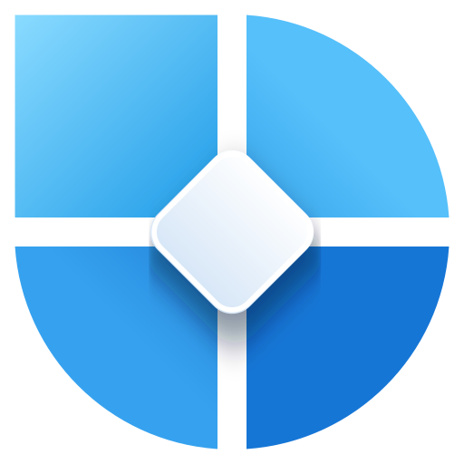
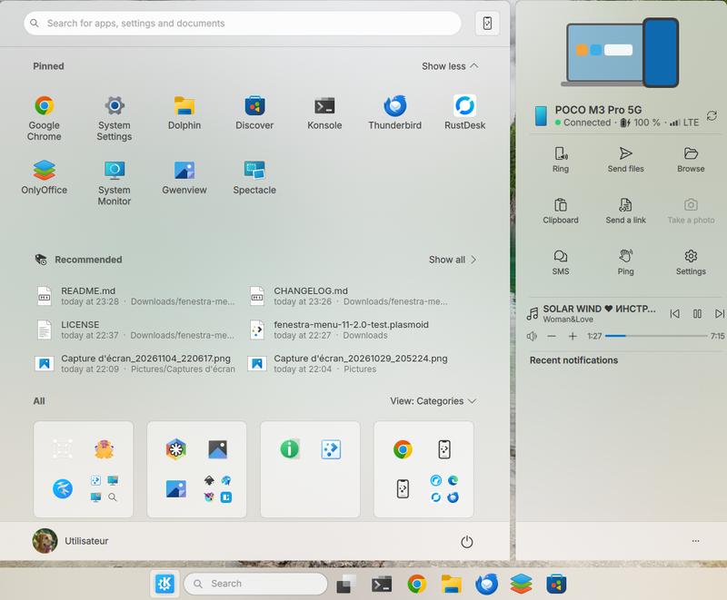

<p align="center">
  
</p>

<h1 align="center">Fenestra Menu 11</h1>

<p align="center">
A Windows 11 style start menu for KDE Plasma 6, with a built-in KDE Connect panel for your phone.<br>
Part of the Fenestra series.
</p>

It brings your pinned and recommended apps, all your apps in three views, a search inspired by Windows 11 and, next to the menu, a panel to control your phone through KDE Connect. It is designed in particular for people coming from Windows, so they don't feel lost on a KDE Plasma desktop.

<p align="center"></p>

> Fenestra Menu 11 is a fork of [Menu 11 Next](https://github.com/Eisteed/menu-11-next) by Eisteed, reworked in depth. See [Credits](#credits).

## Features

### Start menu

- **Pinned** apps, with folders, and a **Recommended** section (recent documents and apps).
- **All apps** in three views: **List**, **Grid** or **Categories** (one tile per category), switchable from the menu.
- Menu width adapts to the screen: 6, 7 or 8 columns (below 1900 px, 1900–2499 px, 2500 px and above). The window keeps a fixed size, according to the number of icons displayed.
- **Search** for apps, files, settings and actions, with filters, a built-in calculator (`/calc`) and `Alt+1–9` to launch a result. A back arrow returns to the first page.
- **Web search** as the last line of the results, with the engine chosen in KDE settings; without any local result, it goes straight to the web search. A **Settings** button next to the filters opens the KDE search settings (to switch from Google to DuckDuckGo, for example).
- Optional shell command runner (`> command`) and optional quick actions bar (screenshot, lock, terminal…).
- Footer with your **account** (avatar, name, manage account, other users) and a **power** menu (lock, sleep, **hibernate**, restart, shut down, sign out). You choose which buttons appear in the menu settings.
- **New** badge on newly installed apps, and a notification telling you in which category the app was filed.

### KDE Connect panel

- Opens next to the menu with the KDE Connect button; menu and panel stay **centered together** on the screen, and the menu glides aside when the panel opens or closes.
- Setting **Keep the KDE Connect panel open between menu openings** (on by default): the button works as a switch and the panel comes back with the menu. Turned off, the panel opens on demand and closes together with the menu.
- Phone status: name, connection, **battery** (with charging indicator), mobile network, and a **Refresh** button.
- Actions: **Ring**, **Send files**, **Browse**, **Clipboard**, **Send a link**, **Take a photo** (if the phone supports it), **SMS** (with your phone contacts), **Ping**, **Settings**.
- **Media card** when music plays on the phone: title, artist, previous / play-pause / next, volume, progress.
- **Recent notifications**, with reply and dismiss.
- Step-by-step **pairing guide** for Android and iPhone.
- **···** menu: open KDE Connect, hide the panel.

## Requirements

- **KDE Plasma 6** (Qt 6). Plasma 5 is not supported.
- **Wayland** session. X11 is not supported.
- For the KDE Connect panel: **KDE Connect** installed and a paired phone, `qdbus` (`qdbus6` or `qdbus-qt6`) and `python3`.
- For **Hibernate**: a computer set up for hibernation (swap space large enough). The button only appears when the computer supports it.

## Installation

### From the KDE Store

Right-click the panel → **Add or Manage Widgets** → **Get New Widgets** → search for **Fenestra Menu 11**.

### Manual

```bash
git clone https://github.com/naykkalak/fenestra-menu-11.git
kpackagetool6 -t Plasma/Applet -i fenestra-menu-11
```

Then replace your current menu: right-click the Start button → **Show Alternatives…** → **Fenestra Menu 11**.

To update a manual install: `kpackagetool6 -t Plasma/Applet -u fenestra-menu-11`.

## Languages

English, Chinese (Simplified and Traditional), Dutch, French, German, Italian, Japanese, Polish, Portuguese (Portugal and Brazil), Russian, Spanish and Turkish. The menu follows the language of your system and falls back to English.

Translations other than French are machine-assisted and **should be reviewed by native speakers**: corrections are welcome (files in `translate/`).

## Credits

- **[Menu 11 Next](https://github.com/Eisteed/menu-11-next)** by Eisteed (GPL-2.0-or-later), the starting point of this fork.
- **[Menu 11 / OnzeMenuKDE](https://github.com/adhec/OnzeMenuKDE)** and **Ditto Menu** by adhe (GPL-2.0-or-later), on which Menu 11 Next is based.
- **KDE** launcher code by Eike Hein, Aurélien Gâteau, Ivan Čukić and Weng Xuetian (GPL-2.0-or-later). Their copyright notices are kept in the source files.
- **Icons**
  - KDE Connect panel pictograms (`contents/icons/kdeconnect/`), search back arrow and settings gear (`contents/icons/fluent/`): [Fluent UI System Icons](https://github.com/microsoft/fluentui-system-icons), © Microsoft Corporation, MIT License (license file included).
  - Power button and power menu icons (`contents/icons/status/system-*-v2.svg`): [Fluent UI System Icons](https://github.com/microsoft/fluentui-system-icons), © Microsoft Corporation, MIT License.
  - KDE Connect button (`contents/icons/status/kdeconnect.svg`): from the [KDE-Windows-Modern](https://github.com/Jeysef/KDE-Windows-Modern) icon theme by Jeysef, GPL-3.0.
  - Phone battery and mute icons (`contents/icons/status/`): original creations for Fenestra.

## Also in the Fenestra series

- [Fenestra Weather](https://github.com/naykkalak/fenestra-weather-icons): weather icon pack
- [Fenestra Weather Widget](https://github.com/naykkalak/fenestra-weather-widget): weather widget
- [Fenestra SDDM](https://github.com/naykkalak/fenestra-sddm): login screen
- [Fenestra Search](https://github.com/naykkalak/fenestra-search): search bar
- [Fenestra This PC](https://github.com/naykkalak/fenestra-ce-pc): “This PC” window

## License

Fenestra Menu 11 is distributed under the **GNU General Public License v3.0 or later** (see [LICENSE](LICENSE)).
Files inherited from Menu 11 Next and KDE keep their original GPL-2.0-or-later notices, a license that allows this redistribution under GPL-3.0-or-later.

*Not affiliated with or endorsed by Microsoft. “Windows” is a trademark of Microsoft Corporation and is only used here to describe the style.*
